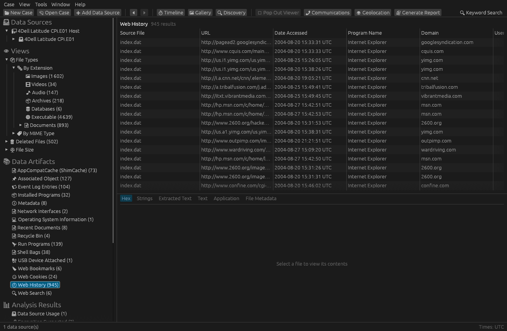
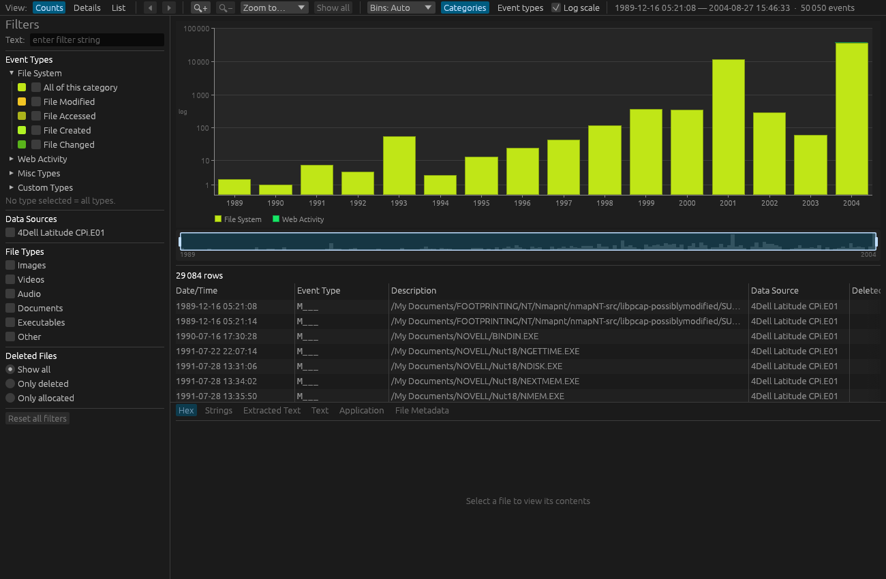

<p align="center">
  <picture>
    <source media="(prefers-color-scheme: dark)" srcset="assets/brand/postmortem-wordmark-on-dark.png">
    
  </picture>
</p>

<p align="center">
  <b>A fast digital forensics workbench in pure Rust.</b><br>
  A port of <a href="https://www.autopsy.com">Autopsy</a>: one download, no Java, no Solr.
</p>

<p align="center">
  <a href="https://github.com/tatupesonen/postmortem/actions/workflows/ci.yml"></a>
  <a href="https://github.com/tatupesonen/postmortem/releases/latest"></a>
  <a href="LICENSE"></a>
</p>

<p align="center">
  
</p>

## Features

- **Evidence:** raw, split and E01 disk images and VMDK, VHD, VHDX and QCOW2 virtual disks; NTFS, FAT, exFAT and ext file systems, including deleted files
- **Analysis:** web activity, Windows registry, event logs, jump lists and prefetch, hash sets (MD5, SHA-1, SHA-256), file type detection, keyword search, e-mail (MBOX, EML, vCard), archives, carving, encryption detection, EXIF and GPS
- **Review:** timeline, file discovery, image gallery (duplicates shown once), communications, geolocation map, tags, result tabs, pop-out viewers
- **Reports:** HTML, Excel, KML, body file, file lists and tagged-hash sets
- **AI agents:** a built-in [MCP](https://modelcontextprotocol.io) server lets Claude and other assistants search and cite a case
- **Plugins:** sandboxed WebAssembly ingest modules, written against the same API as the built-in parsers
- **Command line:** `postmortem ingest` creates a case and analyses images without the GUI

Evidence is only ever read, never modified.

<p align="center">
  
</p>

## Get it

Download a build for Windows, macOS or Linux from [Releases](https://github.com/tatupesonen/postmortem/releases), or build it yourself:

```sh
cargo run --release -p postmortem
```

## Ask an AI about your case

`postmortem mcp` serves a case over the Model Context Protocol, read-only by default. Every result carries a reference (`file:123`, `artifact:45`) that opens in the app, and text from the evidence is marked as untrusted, so it can't steer the assistant. For Claude Code:

```sh
claude mcp add my-case -- postmortem mcp --case ~/postmortem/Cases/MyCase
```

Run `postmortem mcp --help` for the HTTP transport, image previews and write access.

## Write a plugin

Plugins are WebAssembly components that run sandboxed in the ingest pipeline. Copy the [example plugin](plugins/examples/big_round_files), build it for `wasm32-wasip2` and drop it in `~/postmortem/Plugins`. See [`docs/PLUGINS.md`](docs/PLUGINS.md).

## Status

Early and under active development. [`docs/PARITY.md`](docs/PARITY.md) tracks progress towards feature parity with Autopsy.

## License

[AGPL-3.0-or-later](LICENSE). The plugin API and SDK (`pm-plugin-api`, `pm-plugin-sdk`) are [Apache-2.0](LICENSE-APACHE), so plugins can use any licence. See [`NOTICE`](NOTICE) for Autopsy and third-party attributions.

postmortem is not affiliated with or endorsed by the Autopsy project.
